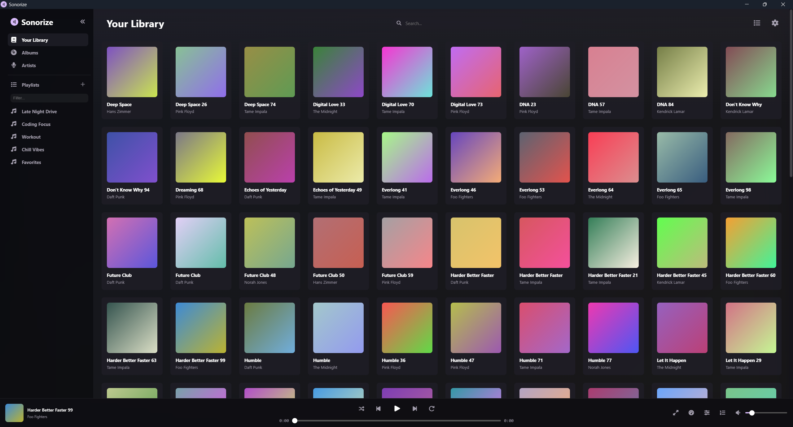

# 🎵 Sonorize

**Sonorize** is a modern, customizable desktop music player built with .NET 10 and Blazor Hybrid (Photino). It is designed to provide a clean, web-based interface for your local music library while offering native desktop performance and advanced audio controls.



> ⚠️ **Status: Experimental**
>
> This project is in early development. It has currently **only been tested on Windows**. You may encounter bugs or incomplete features.

## ✨ Features

* **Local Library:** Scans folders to organize tracks by Artist, Album, and Duration.
* **Audio Engine:** Powered by **BASS**. Includes a 10-band Equalizer, plus Tempo (Speed) and Pitch controls.
* **Customization:** Robust theming engine. Change colors, layouts, or inject your own CSS.
* **Focus Mode:** A minimalist, distraction-free view for the currently playing track.
* **Metadata Editor:** Edit tags (Title, Artist, Album, etc.) directly within the app.
* **Last.fm:** Built-in real-time scrobbling.
* **Drag & Drop:** Drag files directly onto the window to play them instantly.

## 🛠️ Tech Stack

* **.NET 10**
* **Photino.Blazor** (Lightweight cross-platform desktop wrapper)
* **Terminal.Gui v2** (Terminal frontend, `Sonorize.Tui`)
* **ManagedBass** (C# wrapper for the Un4seen BASS audio library)
* **Inflatable.Lastfm** (Scrobbling API)

## 🚀 Getting Started

### 1. Prerequisites

* Install the **.NET 10 SDK**.

### 2. Clone the Repository

```bash
git clone https://github.com/yourusername/sonorize.git
cd sonorize
```

### 3. Setup Audio Dependencies (BASS)

Sonorize requires the native `bass` library and `bass_fx` add-on. Opus playback additionally requires the optional `bassopus` add-on.

* The application checks for the core BASS and BASS_FX libraries and provides setup guidance when they are missing.
* For development, place the native libraries in the application output directory (next to `Sonorize.exe` on Windows).
* To enable Opus playback, download **BASSOPUS** from the [official BASS add-ons page](https://www.un4seen.com/bass.html#addons) and place the matching native plugin beside the BASS library:
  * Windows x64: `bassopus.dll`
  * Linux x64: `libbassopus.so`
  * macOS: `libbassopus.dylib`

Without BASSOPUS, Sonorize can still index Opus tracks, but it cannot play them. Other supported audio formats are unaffected.

### 4. Enable Scrobbling (Optional)

The source code does not include API keys. To enable Last.fm features when building from source:

1. Navigate to `Sonorize.Core/Scrobbling/`.
2. Create a new file named `Secrets.Private.cs`.
3. Paste the following code, replacing the placeholders with your own Last.fm API credentials:

```csharp
namespace Sonorize.Core.Scrobbling;

public static partial class Secrets
{
    static partial void InjectLastFmKeys(ref string apiKey, ref string apiSecret)
    {
        apiKey = "YOUR_API_KEY";
        apiSecret = "YOUR_SHARED_SECRET";
    }
}
```

*If you skip this step, the app will run normally, but Scrobbling will be disabled.*

### 5. Run

```bash
dotnet run --project Sonorize.Photino.Blazor
```

### 6. Terminal UI (Optional)

`Sonorize.Tui` is a keyboard-driven terminal frontend built on the same `Sonorize.Core` services. It shares the settings, library cache and Last.fm session with the desktop app, so only one of the two can run at a time.

```bash
dotnet run --project Sonorize.Tui
```

It covers the core player: browsing songs, artists, albums and the queue, search, and playback controls. Colours come from your terminal's own 16-colour palette and default background, so it follows your terminal theme. The current track's cover art is shown under the sidebar in terminals that support the Kitty graphics protocol or Sixel; elsewhere the panel is hidden (press `c` to force a rough 16-colour version). Playlists, the equalizer, theming and the metadata editor are only available in the desktop app.

| Key | Action |
| --- | --- |
| `Enter` | Play song / open artist or album |
| `Space` | Play / pause |
| `n` / `p` | Next / previous track |
| `←` / `→` | Seek 5 seconds |
| `+` / `-` | Volume |
| `s` / `r` | Shuffle / repeat |
| `c` | Show / hide cover art |
| `1`–`4` | Songs / Artists / Albums / Queue |
| `/` | Search (`Esc` clears) |
| `a` | Add a music folder |
| `F5` | Rescan library |
| `?` | Show all keys |
| `q` | Quit |

The BASS libraries from step 3 are needed here too (`libbass.so` / `libbass.dylib` on Linux and macOS).

## 🤝 Contributing

Contributions are very welcome!

Since this project is experimental, bug reports and feature suggestions are highly appreciated. If you attempt to run this on **macOS** or **Linux**, please share your experience in the issues tab to help us improve cross-platform support.

#### 📄 License

The source code for **Sonorize** is licensed under the **MIT License**.

**Important Notes Regarding Third-Party Dependencies:**

1. **BASS Audio Library**

   - This project relies on the **BASS** audio library (Un4seen Developments) for playback.
   - **BASS** is free for **non-commercial** use.
   - Commercial use requires obtaining a separate license from Un4seen Developments.
   - For the most current and complete licensing terms, please refer to the official BASS website.

2. **SkiaSharp and Skia**

   - This project uses **SkiaSharp** for album art decoding, resizing, and pixel analysis.
   - SkiaSharp is licensed under the **MIT License**.
   - The underlying Skia graphics library is licensed under the **BSD 3-Clause License**.
   - The application includes platform-specific native Skia assets for supported targets.

> **Disclaimer:**
> Sonorize includes third-party libraries that are licensed separately by their respective authors.
> The Sonorize project and its contributors do **not** own these libraries and cannot grant or validate licenses for them.
> Users are responsible for ensuring compliance with all third-party licensing requirements when using, modifying, or distributing this software.
